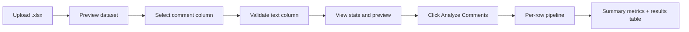
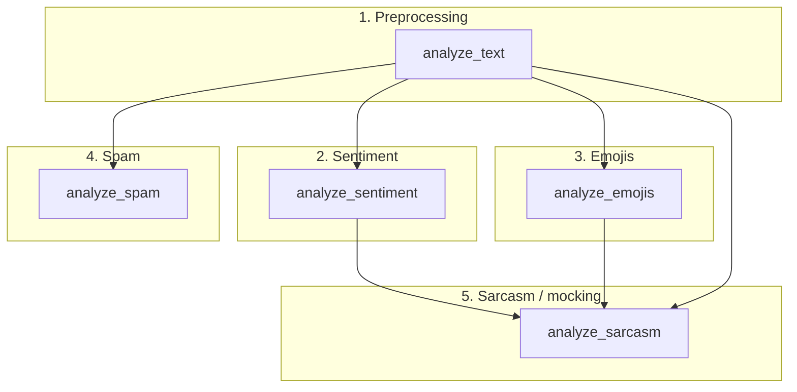

# Social Media Comment Intelligence

A **Streamlit** web app that ingests social media comments from an Excel workbook and runs a multi-stage, rule-augmented analysis pipeline on each row. The goal is to go beyond a single sentiment label by combining **lexicon-based sentiment (VADER)**, **emoji categorization**, **spam / hashtag-hijacking heuristics**, and **sarcasm / mocking detection**—while keeping each step transparent and inspectable.

---

## Objective

Social media comments are short, noisy, and full of signals that plain text classifiers often mishandle: emojis, hashtags, URLs, repetition, irony, and promotional spam. This project aims to:

1. **Quantify overall sentiment** using VADER, which is tuned for informal language and punctuation.
2. **Interpret emoji usage** separately from lexical sentiment, including laughter and “sarcasm-adjacent” emoji cues.
3. **Flag likely spam and hashtag abuse** with weighted, explainable rules (scores plus human-readable reasons).
4. **Surface sarcasm and mocking** by combining sentiment, emoji tone, phrases, and punctuation—without treating a single emoji as proof.
5. **Deliver analyst-friendly output**: one row per comment with many feature columns, summary metrics in the UI, and no black-box ML for the heuristic layers.

The application is aimed at **community managers, researchers, and analysts** who export comment threads to Excel and need a repeatable first pass before deeper modeling or manual review.

---

## How It Works (End-to-End Process)

### User workflow (application)



1. **Upload** an Excel file (`.xlsx`) via the file uploader.
2. **Inspect** the full dataframe and list of column names.
3. **Choose** the column that contains comment text. The app rejects columns that look entirely numeric.
4. **Review** total / non-empty / empty comment counts and a 10-row preview.
5. **Run analysis** with **Analyze Comments**. A progress bar updates as each row is processed.
6. **Explore** aggregate metrics (text features, sentiment distribution, emoji breakdown) and the detailed per-comment results table.

### Per-comment processing pipeline

For **each comment**, the app runs five service modules in a fixed order. Later stages consume outputs from earlier ones.



| Step | Module | Input | Role |
|------|--------|--------|------|
| 1 | `services/preprocessing.py` | Raw comment cell | Normalize text; extract emojis, hashtags, URLs; count `!` / `?`; detect excessive character repetition; produce `cleaned_text`. |
| 2 | `services/sentiment.py` | Original comment text | VADER `polarity_scores` → `compound_score` and POSITIVE / NEUTRAL / NEGATIVE label (thresholds ±0.5 on compound). |
| 3 | `services/emoji_analysis.py` | Emoji list from step 1 | Rule-based categories (positive, negative, laughter, sarcasm/mocking signal, surprise, neutral); overall `emoji_sentiment`; `sarcasm_emoji_detected` flag. |
| 4 | `services/spam_analysis.py` | Text + hashtags + URL + repetition flags | Weighted `spam_score`, `spam_reasons`, optional `spam` boolean; hashtag-hijacking heuristics. |
| 5 | `services/sarcasm.py` | Text + VADER + emoji outputs + punctuation counts | Weighted `sarcasm_score` / `mocking` signals with conservative detection thresholds. |

Results from all steps are **merged into one dictionary per row**, then assembled into a `pandas` DataFrame for display.

---

## Logical Breakdown of the Project

### Layer 1: Presentation (`app.py`)

- **Streamlit** UI: upload, column selection, validation, metrics, and results.
- **Orchestration only**: no business logic beyond looping comments and calling service functions.
- **Progress feedback** during batch processing.
- **Curated display columns** so the table focuses on the most useful fields (comment text, cleaning, sentiment, emoji, spam, sarcasm).

### Layer 2: Feature extraction (`preprocessing.py`)

Think of this as the **single source of structured features** for social-style text:

- **Preservation**: `original_text` is kept unchanged for sentiment and pattern matching.
- **Cleaning**: whitespace normalization and collapsing runs of 4+ repeated characters to two (e.g. `sooooo` → `soo`) in `cleaned_text`.
- **Structured tokens**: emoji and hashtag lists, boolean URL presence, repetition flag, punctuation counts.

Empty, `None`, or NaN cells return a consistent empty result shape so downstream modules do not need special cases in the UI loop.

### Layer 3: Lexicon sentiment (`sentiment.py`)

- Uses **VADER** (`vaderSentiment`) with a **shared analyzer instance** for performance.
- Classifies using **compound score** with project thresholds: ≥ 0.5 → POSITIVE, ≤ −0.5 → NEGATIVE, else NEUTRAL.
- Exposes `positive_score`, `neutral_score`, and `negative_score` for transparency.

### Layer 4: Emoji semantics (`emoji_analysis.py`)

- **Not ML**: a fixed map from common emojis to categories.
- Splits emoji clusters into individuals; resolves multi-codepoint emojis where listed.
- **`emoji_sentiment`**: rule-based rollup (e.g. POSITIVE + NEGATIVE → MIXED).
- **`sarcasm_emoji_detected`**: documents presence of emojis often associated with mockery—it is an **input signal** to sarcasm logic, not a final sarcasm verdict.

### Layer 5: Spam and hashtag hijacking (`spam_analysis.py`)

- **Spam score** (0–1): sum of weighted reasons (promotional phrases, promotional hashtags, hashtag volume, URL, repetition), capped at 1.0.
- **`spam` is True** only when score ≥ 0.55 **and** there is a “strong” reason (or URL + repetition at high score)—so a lone link does not auto-label spam.
- **Hashtag hijacking**: separate heuristic flags when many hashtags look unrelated to comment words, or short text carries many promo/trend tags.

### Layer 6: Sarcasm and mocking (`sarcasm.py`)

- **Sarcasm** and **mocking** are scored separately; both require **multiple corroborating signals** before `sarcasm_detected` or `mocking_detected` flip to True.
- Key ideas:
  - **Contradiction**: strong positive VADER vs mocking emoji or negative emoji tone.
  - **Phrases**: curated sarcastic / mocking multi-word phrases (ambiguous phrases weighted lower).
  - **Praise + ridicule**: positive words with laughter or clown/eye-roll emojis.
  - **Punctuation**: extra `!` or `?` only nudge the score when other cues already exist.

This design favors **explainability** (`sarcasm_reasons`, `mocking_reasons`) over aggressive auto-labeling.

---

## Project Structure

```
sentiment_analysis/
├── app.py                      # Streamlit UI and analysis orchestration
├── services/
│   ├── preprocessing.py        # Text features and cleaning
│   ├── sentiment.py            # VADER sentiment
│   ├── emoji_analysis.py       # Rule-based emoji categories
│   ├── spam_analysis.py        # Spam score and hashtag hijacking hints
│   └── sarcasm.py              # Sarcasm and mocking heuristics
├── test_sentiment.py           # Small VADER sanity script
├── test_preprocessing          # Preprocessing tests / experiments
└── README.md
```

---

## Requirements and Setup

Dependencies are implied by the code (no `requirements.txt` in the repo yet). Install in a virtual environment:

```bash
python -m venv .venv
.venv\Scripts\activate          # Windows
pip install streamlit pandas openpyxl vaderSentiment
```

Run the app:

```bash
streamlit run app.py
```

The app opens in your browser (default Streamlit URL: `http://localhost:8501`).

---

## Input Data

| Requirement | Details |
|-------------|---------|
| Format | Excel `.xlsx` (read with `openpyxl`) |
| Content | At least one column with comment text |
| Types | Text-like values; purely numeric columns are blocked for the comment field |

---

## Output Fields (per comment)

After analysis, the results table includes (among others):

| Field group | Examples |
|-------------|----------|
| Text | `comment`, `cleaned_text` |
| Emojis | `emojis`, `emoji_count`, `emoji_sentiment`, `emoji_categories`, `sarcasm_emoji_detected` |
| Social tokens | `hashtags`, `hashtag_count`, `has_url`, `excessive_repetition`, `exclamation_count`, `question_count` |
| Sentiment | `sentiment_label`, `compound_score`, `positive_score`, `neutral_score`, `negative_score` |
| Spam | `spam_score`, `spam_reasons`, `hashtag_hijacking_signal`, `hashtag_hijacking_reasons` |
| Sarcasm | `sarcasm_score`, `sarcasm_detected`, `sarcasm_reasons`, `mocking_detected`, `mocking_reasons` |

The UI also shows rollups: comments with emojis/hashtags/URLs/repetition, sentiment counts, and emoji-sentiment buckets.

> **Note:** `analyze_spam` also computes a boolean `spam` field internally; the current Streamlit table focuses on `spam_score` and `spam_reasons` for review. You can add `spam` to `display_columns` in `app.py` if you want the flag visible in the grid.

---

## Design Principles and Limitations

- **Heuristic layers are intentionally conservative**—high scores and multiple reasons reduce false positives on sarcasm and spam.
- **VADER** can read ironic praise as positive; sarcasm detection tries to correct that only when other signals align.
- **Hashtag “relatedness”** is word-overlap heuristics, not true topic modeling.
- **Language**: rules and VADER are **English-oriented**; other languages may degrade in accuracy.
- **Scale**: processing is **row-by-row in Python**; very large sheets may be slow without batching or export-to-CSV workflows added later.

---

## Testing

- `test_sentiment.py` — quick manual check of VADER scores on sample sentences.
- `test_preprocessing` — preprocessing-related checks (see file in repo).

For automated regression tests, consider expanding pytest coverage around `analyze_text`, `analyze_spam`, and `analyze_sarcasm` with fixed comment fixtures.

---

## Summary

| Aspect | Description |
|--------|-------------|
| **What** | Excel-driven social comment analyzer with sentiment, emoji, spam, and sarcasm features |
| **How** | Streamlit front end + modular `services/` pipeline per comment |
| **Why** | Transparent, explainable signals for real-world messy comment data |
| **Next steps (ideas)** | `requirements.txt`, CSV export, include `spam` in UI, batch/parallel processing, optional ML layer on top of extracted features |
